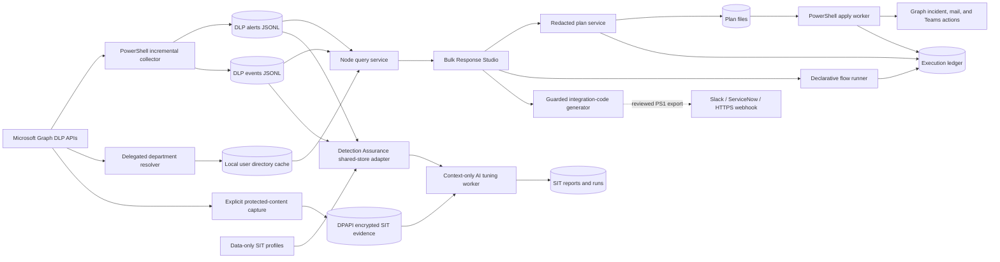

# Architecture

## Boundary

DLP Response Studio accepts only Microsoft Purview DLP alerts and DLP alert events as analytical inputs. Microsoft Graph user, incident, mail, and collaboration endpoints are used only for optional enrichment or explicitly approved response actions.

## Components

## JSONL semantics

The alert store is compacted by alert ID on each sync because alerts can change status, severity, and incident association. The event store is append-only and deduplicated by event ID during collection. A buffered alert watermark captures late updates.

The query service streams the event store and resolves each event to one alert from explicit persisted parent-alert lineage or, for legacy events, a unique detector-ID and alert-activity-window match. Ambiguous and unmatched ownership fails closed. It never loads the complete event store into memory. Matching detections are bounded by configured scan, result, and plan caps.

Department is not expected to exist in DLP event payloads. On explicit operator request, the department resolver performs bounded, read-only Microsoft Graph user lookups and merges `displayName`, `department`, and `mail` into a local UPN-keyed cache. The query service joins that cache after event ownership resolution and before local facet filtering. This join cannot change event-to-alert ownership, the source JSONL, or the upstream Graph collection query.

## Privacy

Detected values can include credentials or regulated content. The collector replaces them with `[REDACTED]` by default before persistence. The query service also redacts its projection unless configuration explicitly states otherwise. The UI never requires raw detected values.

## Trust and execution

- The HTTP service binds to loopback by default.
- Plan creation cannot execute PowerShell or mutate Graph.
- Live apply must be enabled at service startup.
- The apply request must contain the configured confirmation phrase.
- PowerShell workers request only scopes required by selected actions.
- Department enrichment is independent of live apply. It requests delegated `User.Read.All`, calls only Microsoft Graph user `GET` endpoints, validates and bounds submitted UPNs, and stores no access tokens.
- Missing users and blank departments fail open for display but fail closed for department filtering: unresolved users remain visible when no Department filter is selected and cannot match a named Department filter.
- Teams notifications create or reuse one-to-one chats and send only the administrator-reviewed message. Affected-user identities come from the selected DLP scope unless the administrator supplies explicit recipients; detected values are never inserted automatically.
- Flow configuration contains declarative action objects, not executable script bodies.
- File identifiers are validated and resolved only under configured data directories.
- The dedicated bulk-response page executes queued flows sequentially through the same guarded flow API; dry-run is available in read-only mode and live release remains server-gated.
- Response Studio authors only allow-listed declarative actions, derives required Graph scopes server-side, versions every save, and discards executable script fields during normalization.
- Integration scripts are deterministic exports, not response-flow actions. The Studio neither persists nor executes their code. Templates enforce loopback-only source access, environment-based destination credentials, minimized payloads, incremental state, deduplication, and an operator-reviewed dry-run path.
- Detection Assurance uses the same alert and event JSONL stores as DLP Response for scoping and context-only analysis. Shared-store runs skip Graph authentication and collection, apply the profile policy and exact SIT filters after fail-closed alert/event ownership resolution, and write profile-scoped outputs under the workbench data directory.
- When the local directory cache contains a department for an event user, Detection Assurance joins the department before redacting the identity. The model receives department as organizational metadata for concentration, ownership, pilot, and validation analysis; it never receives the lookup UPN in context-only mode. Department coverage is retained in job and run metadata, and department alone cannot justify suppression.
- Detection Assurance assessment periods are inclusive UTC calendar-day filters applied after the existing shared JSONL or DPAPI-protected store is loaded. They never modify Graph collection queries. Each run snapshot retains its start date, end date, and duration so two non-overlapping periods can be compared with the same saved tuning profile.
- Every Detection Assurance chunk prompt also carries a non-overridable incident-triage contract, independent of operator-authored profile language. For each correlated incident, Azure OpenAI must return `HIGH`, `MEDIUM`, or `LOW` priority plus a bounded security comment, disposition, validity status, and evidence count. Redacted runs cannot claim that a credential is live or active. The worker strips identities, URLs, and long token-like artifacts before writing the triage interchange; the Node service sanitizes it again before DLP Response consumes it.
- DLP Response joins the latest Detection Assurance triage by incident ID without changing KQL or Microsoft Graph collection filters. Declarative `incidentPatch` actions can opt into `includeSitTriageComment`; dry runs preview the comment, while confirmed live runs add risk tags and post the reviewed comment through `POST /security/incidents/{incidentId}/comments` using the existing `SecurityIncident.ReadWrite.All` permission.
- SIT model routing is cost-aware: `gpt-5.6-luna` performs the high-volume chunk extraction and incident triage, while the configured reporting model performs bounded consolidation, final reports, and deployable Purview change plans. `SIT_ANALYSIS_MODEL` can override the analysis deployment without changing the report model.
- The Configuration blade persists only validated Microsoft Foundry endpoint and deployment names to the local settings override. It rejects credential-shaped fields, never returns the API key, reports environment-variable precedence, and requires restart-based activation. `AZURE_OPENAI_REPORTING_KEY` remains process-environment-only.
- Sensitive-content tuning uses a physically separate DPAPI CurrentUser-encrypted event store. Capture requires configuration enablement and an exact confirmation phrase; analysis requires a second phrase. Node only reports aggregate readiness and never decrypts or returns evidence. The PowerShell analysis worker decrypts under the capture identity immediately before constructing the profile-scoped Azure OpenAI request.

## Future evolution

JSONL is retained for portability and compatibility. If query latency becomes unacceptable, storage can move behind the `queryDlpEvents` contract without changing the browser or remediation APIs.
